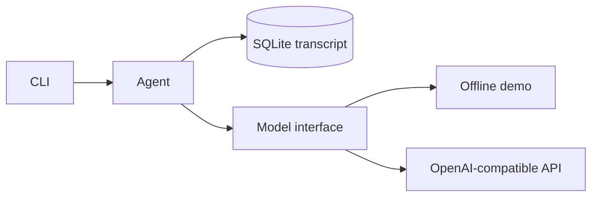

# 技术架构 V0.1

## 当前目标

建立一个最小、可替换、可测试的智能体运行闭环。当前只实现基础设施，不将讨论中的研究假设当作最终架构。

单轮流程：读取最近有限轮对话 → 组装系统提示词与当前输入 → 请求模型 → 原子保存完整对话轮次 → 返回回复。

模型与存储通过协议接口注入，便于单元测试和替换。单进程、单用户、同步运行。历史窗口按轮数而非 token 限制，尚未实现上下文预算。

## 已实现的可选扩展

### 长期记忆 V1
见 [长期记忆设计](long-memory.md)。独立保存用户明确表达的事实、经历与偏好，提供来源校验、修订和检索。

### 动态个人理解 V1（实验性）
见 [动态个人理解设计](personal-understanding-v1.md)。通过 Evidence → Claim → ClaimVersion → Revision 建立有证据、可修订的个人理解。它与长期记忆分表存储，不覆盖长期记忆的提取和检索流程。

- 默认关闭；CLI 使用 `--personal-understanding` 显式启用。
- Agent 只在启用时检索理解并在回复后排队/处理更新；默认 Agent 调用路径不变。
- 重要纠正由关键词规则触发即时更新；普通证据按最多 5 轮批处理。当前实现是同步原型，达到阈值时会在 `reply()` 返回前执行更新模型调用。
- 个人理解检索不额外调用模型，使用有限词法匹配和反思类问题维度加权；最多注入 7 条、上下文上限 6000 字符，尽量覆盖价值、目标和现实约束。
- SQLite 与对话共用连接；删除来源轮次会级联清理证据、无证据版本和命题。

### 尚未实现的研究方向

1. R-State：未完成讨论、双方约定等关系连续性状态的独立模型。
2. 全量周期复核：当前 20 轮触发点只处理积压队列，不执行独立的全量 Claim 审查。
3. 后台 worker：普通批处理当前仍由同步调用触发，尚无常驻/异步调度器。
4. 语义级理解检索、完整敏感信息分类和正式隐私安全评估。
5. 主动关注、主动通知及用户可视化的理解管理界面。

每个扩展都应先由具体用例和失败样本驱动，不预先构建空壳系统。

## 隐私与当前限制

默认数据文件不进入 Git。Demo 与真实模式默认使用不同数据库。真实模式明确将最近历史发送给用户配置的模型服务。SQLite 未加密，/clear 仅为逻辑删除；没有身份认证、多用户隔离、数据库加密、完整敏感信息识别或正式安全评估。长期记忆与个人理解虽已实现为可选扩展，仍属于本地研究原型，不适合直接部署给公众。

## 变更原则

每次改动应明确目标与影响范围。新增能力尽量通过现有边界扩展；不要无关重构。使用离线回归测试保护既有行为，未经验证不得宣称模型效果或认知准确率。

## 后续验收状态

长期记忆与动态个人理解均为可选扩展。功能测试通过仅证明本地流程、来源和数据约束符合测试；真实模型纵向质量仍须通过显式 Live 测试并人工审查，不以 CI 通过代替效果验收。

## API First 服务层（产品化 V1）

当前产品化方向不先开发 Web 页面。FastAPI/Uvicorn 服务通过 `becoming-api` 启动，默认只监听 loopback；Electron 客户端后续复用同一套 JSON API。

- `becoming/api.py`：版本化路由、Pydantic 请求校验、统一错误响应、request ID，以及后台任务查询接口。
- `becoming/api_runtime.py`：单用户运行时、模型配置、会话 Agent 装配、worker 生命周期和 SQLite 生命周期。
- `becoming/background.py`：独立连接的单进程后台 worker，负责长期记忆提取和个人理解更新的持久化调度、重试与恢复；支持暂停屏障，在删除会话或清空数据前排空正在执行的任务。
- `becoming/memory.py`：新增 conversations、background_jobs 表及 turns.conversation_id 迁移；旧 CLI turns 归入 default 会话，近期上下文按会话隔离；消息轮次和后台任务在同一事务入队。
- `becoming/long_memory.py`：每个来源轮次使用 extraction receipt 保证记忆提取重试幂等。
- `becoming/personal_understanding.py`：保留原有专用批处理队列；命题写入与内部 job done 状态原子提交，并支持跨会话隔离的延迟确认补偿。
- `docs/api-v1.md`：路由契约、后台任务状态、启动方式、安全边界和 GitHub HTTP 联调说明。

当前 API 已覆盖健康检查、模型配置/连接测试、会话 CRUD、消息发送、成长预览/确认、长期记忆查看/遗忘、个人理解查看、后台任务状态、数据导出和全量清除。HTTP 消息请求只负责主回复和原子入队；后台 worker 使用独立 SQLite 连接执行记忆提取与个人理解更新，不占用 API runtime 锁。任务最多尝试 3 次，进程重启时会依据记忆 receipt 和个人理解内部任务状态恢复已完成任务，并将耗尽次数的中断任务标记为失败；来源对话删除或全量清除前会暂停 worker 并等待活动任务结束，来源任务再通过外键级联清理。

GitHub Actions 会启动真实 loopback HTTP 服务和本地兼容模型 stub，验证主回复不等待被阻塞的记忆提取、后台任务状态并发读取、暂停屏障、删除/清除与活动任务的协调、重试、重启恢复、记忆提取幂等及个人理解处理。

**当前限制**：API 是本地单用户、单进程单 worker 服务；主聊天模型调用仍同步，后台任务模型调用也使用同步 HTTP，但与聊天请求解耦。尚未提供多 worker 竞争消费、账号认证、多租户隔离、远程部署安全、token streaming 或可靠取消。模型密钥通过 API 更新时只保存在进程内存；未来 Electron Main 负责系统安全存储与启动时注入。当前阶段不做 Web/Electron 页面。
