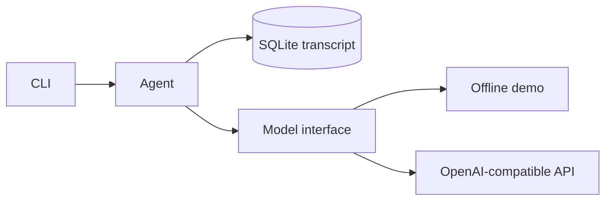

# 技术架构 V0.1

## 当前目标

建立一个最小、可替换、可测试的智能体运行闭环。当前只实现基础设施，不将讨论中的研究假设当作最终架构。

单轮流程：读取最近有限轮对话 → 组装系统提示词与当前输入 → 请求模型 → 原子保存完整对话轮次 → 返回回复。

模型与存储通过协议接口注入，便于单元测试和替换。单进程、单用户、同步运行。历史窗口按轮数而非 token 限制，尚未实现上下文预算。

## 后续独立研究（尚未实现）

1. 记忆：原始信息、可检索的长期记忆、来源和用户纠正机制。
2. 认知：有证据支持的可修正假设，区分用户陈述与模型推断。
3. 反思：即时交流与跨时间分析的职责及触发时机。
4. 自主关注：什么时候思考、什么时候主动交流，以及用户控制与频率限制。
5. 对话能力：普通交流、探索式引导与实际行动辅助的适用边界。

不提前为这些模块编写空壳类或固定数据模型；每个模块独立设计与验证后再集成。

## 隐私与当前限制

默认数据文件不进入 Git。Demo 与真实模式默认使用不同数据库。真实模式明确将最近历史发送给用户配置的模型服务。SQLite 未加密，/clear 仅为逻辑删除；没有身份认证、多用户隔离、长期记忆、工具调用、主动通知或正式安全评估，不适合直接部署给公众。

## 变更原则

每次改动应明确目标与影响范围。新增能力尽量通过现有边界扩展；不要无关重构。使用离线回归测试保护既有行为，未经验证不得宣称模型效果或认知准确率。
